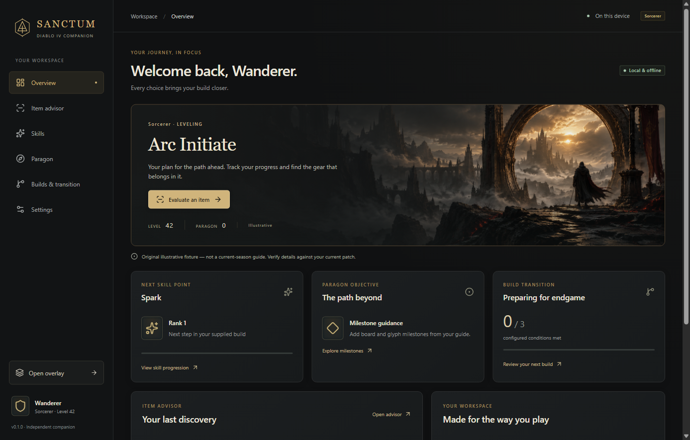
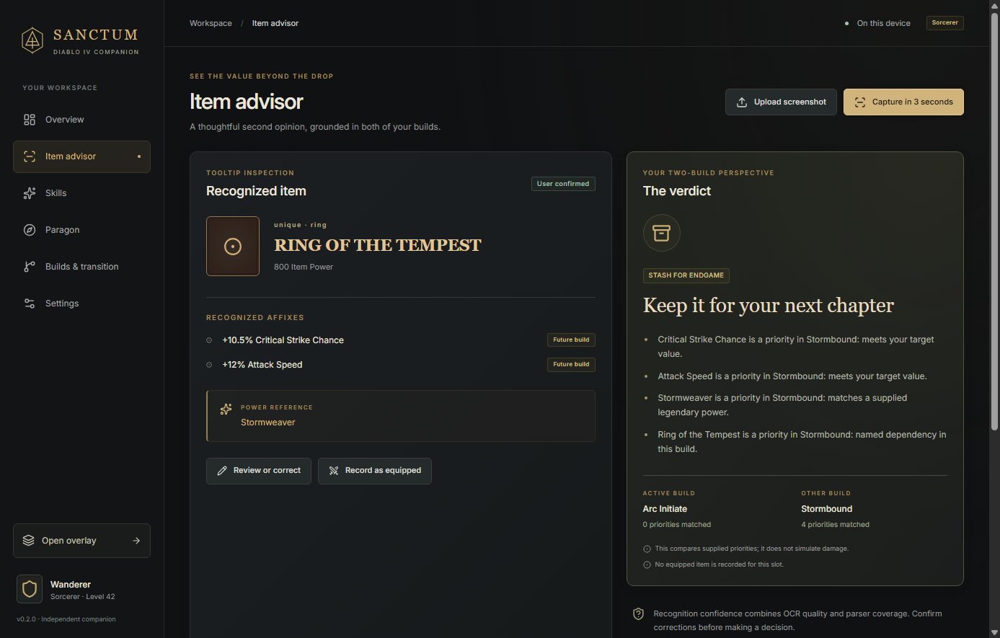

# Sanctum · Diablo IV Companion

A local-first Windows build companion with screenshot OCR, explainable two-build item advice, manual progression and a compact native overlay.





Version **0.1.0 — MVP / prerelease**. This is working software with tested original fixtures, not a complete seasonal planner or an officially approved game integration.

## Install on Windows

Download the x64 NSIS installer or portable executable from [Releases](https://github.com/ldallacqua/diablo-build-companion/releases). The installer runs per user without administrator privileges. Run the portable file directly for a temporary extraction; personal settings still persist in `%LOCALAPPDATA%/DiabloBuildCompanion/`. The English OCR model is bundled, so no first-run download/account is needed. Builds are unsigned; Windows may display an unknown-publisher/SmartScreen notice. Only run packages you trust. Uninstall removes the app while retaining personal data; use Settings → Clear Local Data first if you want it removed.

Windows 11 x64 is the validated target. Windows 10 x64 compatibility is intended but has not been physically tested.

## Your first session

1. Launch Sanctum and choose your own builds or the explicitly illustrative examples.
2. Open **Builds & transition**. Edit one leveling and one endgame build for the same class, or import separate version-1 build JSON files. Export a sample JSON to see every available field. The editor supports ordered skills; its full JSON section supports board/glyph milestones, equipment notes, powers, unique dependencies, roll targets and transition prerequisites.
3. Save optional Maxroll HTTPS guide/planner URLs as references. Automated guide retrieval is unavailable in this release; enter the priorities you need or import your own structured JSON. Keep attribution and current patch metadata. The fictional examples are not game guides.
4. In **Settings**, select a display and set tooltip region X/Y/width/height in logical pixels relative to that display. Save settings.
5. Hover over a visible tooltip and press **Ctrl+Shift+D**. Or upload PNG/JPEG/WebP in Item advisor. Capture-in-3-seconds gives you time to refocus the tooltip.
6. Review parsed attributes, preserved unknown lines and confidence. Correct the text and explicitly confirm when necessary. A named power can be entered as `Aspect: name`. Natural-language power detection is limited; unfamiliar text requires review.
7. Read active/future matches and explanations. Record an item as equipped to enable conservative comparable-roll upgrade checks. The app never sells, equips or allocates anything in the game.
8. Check off skills and Paragon milestones manually. Review configured transition conditions, confirm ownership/manual prerequisites, then accept the endgame transition. Recommendations update immediately. Postpone or return to leveling whenever needed.

## Overlay and assets

Open overlay from the sidebar. Default toggle shortcut: **Ctrl+Alt+Shift+O**. Drag its header; choose compact mode, opacity and click-through in Settings. The hide shortcut works when click-through prevents interaction. Coordinates restore only to connected displays. It is a separate topmost window, intended for borderless desktop use. Actual Diablo IV and exclusive-fullscreen/anti-cheat compatibility remain unverified; use standalone mode and screenshot upload when appropriate.

Optional images: Settings → Personal Asset Library. Supply an asset ID, source and permission/license, then choose an image you may use. It stays in the private local cache. Missing assets use the original icons. No game-file/archive extraction is implemented. See [ASSETS](docs/ASSETS.md) and [COMPLIANCE](docs/COMPLIANCE.md).

## Development

Node 24, pnpm 11.25.0 and Windows:

```powershell
pnpm install --frozen-lockfile
pnpm exec install-electron
pnpm ocr:prepare
pnpm start
```

`pnpm dev` is a browser UI preview; native capture/OCR/overlay requires the desktop build. `pnpm package:win` generates NSIS and portable packages. See [AGENTS.md](AGENTS.md) for architecture and commands, [TESTING](docs/TESTING.md) for actual results and smoke procedures, [RESEARCH](docs/RESEARCH.md) for dated sources, and [ARCHITECTURE](docs/ARCHITECTURE.md) for boundaries and decisions.

## Limits and next steps

Conservative exact-label OCR parsing, English tooltip recognition, manual character/progression synchronization, milestone Paragon guidance, manual/JSON Maxroll fallback and navigation-only Portuguese preview. There is no damage simulator, authoritative seasonal data, automatic tooltip detection, game archive importer, cloud service or telemetry. Screenshot bytes are transient; the latest extracted item text persists. Export your workspace before clearing data.

Roadmap: (1) validate capture/OCR in actual borderless Diablo IV across GPUs/HDR/mixed DPI; (2) expand rights-cleared English/Portuguese tooltip fixtures and power recognition; (3) obtain a permitted Maxroll import interface; (4) sourced seasonal schema packs and verified routes; (5) full localization, signing and optional safe updates. Preserve local deterministic decisions and game/publisher restrictions throughout.

Code and original UI assets are MIT, subject to third-party notices and the generated-art rights qualification. Diablo and Diablo IV names belong to Blizzard Entertainment; use here identifies the target game. No affiliation or approval is implied.
