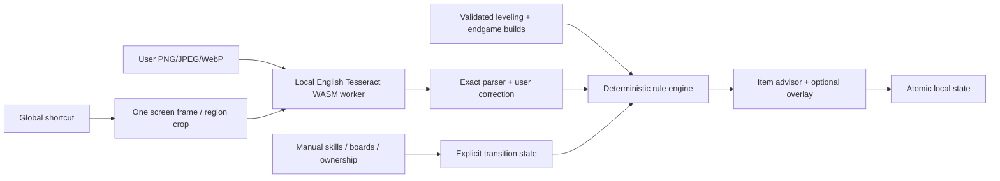

# Architecture

The React renderer is an unprivileged local UI. A narrow, sandbox-compatible preload exposes named operations; the Electron host owns capture, OCR, persistence, global shortcuts and overlay windows. Item decisions run as pure TypeScript functions without the game or desktop host.

Build schema v1 records class, attribution, URL, season/patch, ordered skill allocations, slot requirements, primary/secondary affixes, aliases, roll targets/units/direction, powers, unique dependencies, crafting priorities, board/glyph milestones and typed transition prerequisites. Partial builds remain useful. No missing path is synthesized.

State schema v2 persists character progress, independent per-build checklists, ownership confirmations, transition state, equipped snapshots, settings and the last parsed item. Version 1 migration is explicit; unsupported versions fail validation. Native writes are serialized through a queue and atomic temporary-file rename. A corrupt file produces a warning and is not deleted on read. Browser localStorage is only a preview fallback.

Screen coordinates are display-relative logical pixels, converted using the returned thumbnail/display dimensions rather than assuming one DPI scale. Disconnected displays and out-of-range rectangles produce clear errors. The overlay hides while capturing, retains its position when it intersects a connected work area, falls back to the primary display otherwise and uses native transparency, opacity and click-through. It does not attach to the game process. Software rendering is enabled after a native validation failure with GPU rendering on the test PC.

OCR's English model, worker and WASM core are packaged locally. The worker is initialized lazily and reused. No continuous recording or remote recognition occurs. Screenshots are byte/dimension limited, normalized/resized in memory and then discarded when the view/session changes. Latest extracted text persists for review; screenshot bytes do not.

Extension seams: another validated BuildImporter, a local OCR service, richer data-driven rules, exact route data with provenance, and optional grounded explanation renderers. An external AI model is never required for decisions. The repository has no server, accounts, damage simulator or seasonal database.
